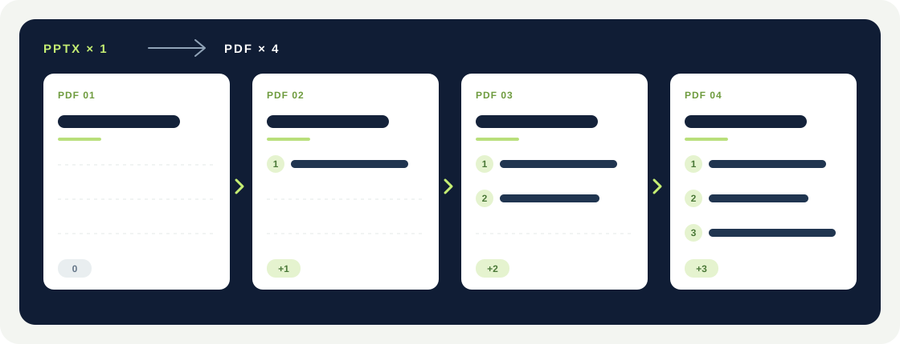
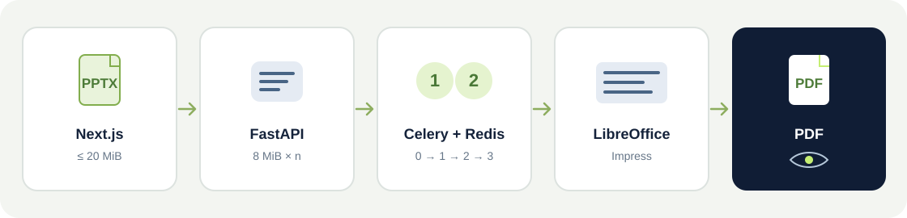

# Slides Bloom

**English** · [繁體中文](README.zh-TW.md) · [简体中文](README.zh-CN.md)

## Use Slides Bloom online

**Website address:** `https://slidesbloom.duckdns.org/`

[Open Slides Bloom online](https://slidesbloom.duckdns.org/)

[Illustrated guide: PPT animation to PDF, click by click](https://slidesbloom.duckdns.org/ppt-animation-to-pdf)

Enter the address above in your browser or use the link to upload a PowerPoint (`.pptx`), convert its click animations into PDF pages, preview the result, and download the PDF. The public site is free to use and requires no installation or account.

**Turn PowerPoint click animations into PDF pages you can read one step at a time.** Slides Bloom is a free, open-source tool you can run on your own server. It expands supported entrance animations in their original click order, keeping previously revealed content on each new PDF page.

## Install the Codex desktop skill from GitHub

This is a local Codex skill, not a plugin for regular ChatGPT web chats. You need the ChatGPT desktop app with Codex, Python 3, and access to the Slides Bloom website. You do **not** need Docker or a local Slides Bloom server.

1. Open **Codex** in the ChatGPT desktop app and start a chat. Paste: `Use $skill-installer to install https://github.com/HuibingLin/slides-bloom/tree/main/.agents/skills/slides-bloom-convert`.
2. After installation, start a new Codex chat. If the skill does not appear, restart the app. Check **Skills** in the sidebar for `slides-bloom-convert`.
3. Open a local project folder in Codex and put your `.pptx` file in that folder. Ask: `Use $slides-bloom-convert to turn my presentation's click animations into a PDF. The file is /absolute/path/to/presentation.pptx`.
4. Codex runs the bundled Python script and gives you a link to the saved PDF. The script uploads the PPTX to `https://slidesbloom.duckdns.org` for conversion; the service accepts files up to 20 MiB. Only use it for files you are willing to send to that service.

### Download and install the entire skill folder manually (macOS)

1. Open the [Slides Bloom GitHub repository](https://github.com/HuibingLin/slides-bloom), select **Code → Download ZIP**, and unzip the download. GitHub downloads the whole repository because its web interface does not offer a folder-only ZIP download.
2. Open the extracted `slides-bloom-main` folder. In Finder, press **Command + Shift + .** if `.agents` is hidden. Go to `.agents/skills/` and copy the **entire** `slides-bloom-convert` folder, including both `SKILL.md` and `scripts/convert.py`. Downloading only `SKILL.md` will not work.
3. In Terminal, run `mkdir -p ~/.agents/skills`. In Finder, press **Command + Shift + G**, enter `~/.agents/skills`, and paste the copied `slides-bloom-convert` folder there. Its final location should be `~/.agents/skills/slides-bloom-convert/SKILL.md`, with the script at `~/.agents/skills/slides-bloom-convert/scripts/convert.py`. Do not add an extra `slides-bloom-main` folder at this location.
4. Open a new Codex chat or restart the desktop app, then check **Skills** in the sidebar for `slides-bloom-convert`. Follow step 3 above to convert a PPTX.

### Download and install the entire skill folder manually (Windows)

These steps are for the **Windows-native Codex agent** in the ChatGPT desktop app. If you switched the agent to WSL, use `~/.agents/skills` in your WSL home directory instead.

1. Open the [Slides Bloom GitHub repository](https://github.com/HuibingLin/slides-bloom), select **Code → Download ZIP**, then right-click the download and choose **Extract All**. GitHub downloads the whole repository.
2. Open the extracted `slides-bloom-main` folder, go to `.agents\skills`, and copy the **entire** `slides-bloom-convert` folder. Check that it contains both `SKILL.md` and `scripts\convert.py`; copying only `SKILL.md` will not work.
3. Open PowerShell and run `New-Item -ItemType Directory -Force "$HOME\.agents\skills"`. Press **Win + R**, enter `%USERPROFILE%\.agents\skills`, and paste the `slides-bloom-convert` folder there. The final files should be `%USERPROFILE%\.agents\skills\slides-bloom-convert\SKILL.md` and `%USERPROFILE%\.agents\skills\slides-bloom-convert\scripts\convert.py`, without an extra `slides-bloom-main` folder.
4. Check that Python 3 is installed by running `py -3 --version` in PowerShell. Start a new Codex chat or restart the desktop app, then check **Skills** in the sidebar for `slides-bloom-convert`.
5. Put your `.pptx` in a local folder Codex can access, then ask: `Use $slides-bloom-convert to turn the click animations in C:\Users\YourName\Documents\demo.pptx into a PDF`. Replace the example with your presentation's full path.

For other local skill locations, see [OpenAI's skill setup guide](https://learn.chatgpt.com/docs/build-skills). For Windows-native versus WSL agents, see the [Windows guide](https://learn.chatgpt.com/docs/app/windows).

## What does the PDF contain?

For one slide with three successive entrances, the PDF contains four pages:



```text
Page 1  Starting slide, before any clicks
Page 2  Starting slide + item 1
Page 3  Starting slide + items 1 and 2
Page 4  Starting slide + items 1, 2 and 3
```

A static slide produces one page. Entrance effects that occur together or immediately after one another during the same click are combined on one PDF page. Original slide order is preserved.

Try a real conversion: download the [one-slide animated PPTX](frontend/public/examples/animation-steps-demo.pptx) and its [four-page PDF](frontend/public/examples/animation-steps-demo.pdf). The [online guide](https://slidesbloom.duckdns.org/ppt-animation-to-pdf) shows all four rendered pages. This example uses simple text entrances; check the preview when converting other effects or fonts.

## Features

- Upload `.pptx` files up to **20 MiB** (shown as 20 MB in the interface). Files are sent in 8 MiB chunks; select the same file again to resume after a network interruption.
- Conversion runs in the background with upload and processing progress in the interface.
- **Preview the finished PDF page by page**, open the full PDF in a new tab, or download it.
- The interface supports English, Traditional Chinese, and Simplified Chinese. English is the default; the browser remembers your language choice.
- Uploaded files and generated PDFs are removed by an hourly cleanup job after the task is at least 24 hours old.

## Tech stack

- **Frontend:** Next.js 15, React 19, TypeScript, and CSS. The interface is built as a static site.
- **API and document processing:** Python 3.12 and FastAPI handle uploads, job status, and PDF previews. `lxml` reads and updates PPTX animation data; LibreOffice Impress renders the expanded slides to PDF, while `pypdf` and `pypdfium2` support PDF processing and previews.
- **Background jobs and storage:** Celery runs conversions and scheduled cleanup; Redis holds the job queue and progress. Uploaded files and PDFs are kept in the configured data directory until cleanup.

## Quick start

Install Docker and Docker Compose. Allow more than 6 GB of memory for Docker if possible: the worker has a 6 GB memory limit. Use a local SSD with several gigabytes free for the data directory, because extraction and rendering can use much more space than the original PPTX.

From the project root:

```sh
cp -n .env.example .env
docker compose up --build -d
```

Open [http://localhost:8080](http://localhost:8080). Edit `.env` before starting if you need a different port or data directory:

```dotenv
PORT=8080
DATA_PATH=./data
```

`DATA_PATH` stores upload chunks, source files, and PDFs. `docker compose down` stops the services but does not remove files still in that directory. Automatic cleanup requires the `beat` service to be running.

### Check the installation

```sh
docker compose ps
curl http://localhost:8080/api/health
```

Upload a PPTX with click-triggered entrance animations. A slide with three clicks should appear as four cumulative pages in the preview. To inspect conversion logs, run `docker compose logs -f worker`.

## How it works



- **Next.js** builds the upload, progress, language, preview, and download interface into static files served by Nginx; no Node.js server runs in production.
- **Nginx and FastAPI** serve the site and API, receive chunks, validate files, and generate preview images.
- **Celery and Redis** process conversions and report progress. The worker runs one task at a time by default, has a 6 GB memory limit, and gives each task at most two hours. Additional uploads wait in the queue.
- **Celery Beat** removes task files older than 24 hours once per hour.

Nginx allows request bodies up to 20 MiB; each upload chunk is smaller. The server also checks PPTX validity and decompressed-size safety limits. **20 MiB is the upload limit**, not a promise that every such file will convert within a particular machine's memory and disk capacity.

## Local development and tests

Start the services with Compose as shown above. For a local frontend development server:

```sh
cd frontend
npm ci
NEXT_PUBLIC_API_BASE=http://localhost:8080 npm run dev
```

The development site runs at [http://localhost:3000](http://localhost:3000) and uses the Compose API at `localhost:8080`. Run `npm run build` in `frontend/` to build the frontend.

Run the backend tests from the project root:

```sh
python3 -m venv backend/.venv
backend/.venv/bin/python -m pip install -r backend/requirements-dev.txt
PYTHONPATH=backend backend/.venv/bin/python -m unittest discover -s backend/tests -v
```

Tests cover the 20 MiB limit, cumulative animation pages, formula-image masking, and unsupported-animation errors. The full upload-to-PDF-preview test requires a local LibreOffice `soffice` installation and is skipped if it is absent. LibreOffice is already included when running the app through Docker.

## API overview

- `GET /api/health`: health check and upload size limit.
- `POST /api/uploads`: create a chunked upload.
- `GET /api/uploads/{upload_id}`: list uploaded chunks.
- `PUT /api/uploads/{upload_id}/chunks/{index}`: upload a chunk.
- `POST /api/uploads/{upload_id}/complete`: finish the upload and queue conversion.
- `GET /api/jobs/{job_id}` and `WS /api/jobs/{job_id}/ws`: read or subscribe to progress.
- `GET /api/jobs/{job_id}/preview/pages/{page_number}`: render a PDF page as PNG; numbering starts at **1**.
- `GET /api/jobs/{job_id}/preview`: open the PDF in the browser.
- `GET /api/jobs/{job_id}/download`: download the PDF.

## Deployment and troubleshooting

- **Upload rejected or HTTP 413:** Check the 20 MiB file limit and any additional reverse proxy's request-body limit.
- **Animation conversion failed:** Check the original slide number shown in the interface and `docker compose logs worker`. Only the entrance animations described above are supported.
- **Formula or symbol appearance changed:** Check for usable fallback images in the PPTX and install source fonts only when licensed to do so. Review each PDF page in the preview.
- **Containers do not start:** Run `docker compose ps` and `docker compose logs --tail=100`. Check for a port conflict and free space in `DATA_PATH`.

There are no user accounts. Before exposing the service publicly, provide HTTPS and add access control, rate limits, and monitoring appropriate to your deployment. The scheduled file removal is ordinary deletion, not storage-level secure erasure.

## Search visibility

The public homepage includes a descriptive title, summary, social sharing image, and software application data. The static build also serves `/robots.txt` and `/sitemap.xml`; the private `/admin/` page is excluded from indexing.

For a custom public domain, set `SITE_URL=https://your-domain.example` in `.env` before building. This value is baked into the frontend's canonical URL, sitemap, and social metadata. After changing it, run `docker compose up --build -d frontend` and then `docker compose restart nginx` so the proxy discovers the rebuilt container. Keep `SITE_DOMAIN` set to the same host when using `compose.oracle.yaml`. Do not set `SITE_URL` to `localhost` for a public deployment.

Once the HTTPS site is reachable without a login, add the domain to [Google Search Console](https://search.google.com/search-console/about). For HTML-tag verification, put the tag's `content` value in `GOOGLE_SITE_VERIFICATION` in `.env`, rebuild the frontend, and click Verify. Then submit `https://your-domain.example/sitemap.xml`. Search engines decide when and whether to index a page; a sitemap does not guarantee a ranking or immediate appearance.

For HTML-file verification instead, place the exact file supplied by Google in `frontend/public/`, rebuild and deploy the frontend, and confirm `https://your-domain.example/<filename>.html` returns Google's exact text before clicking Verify. Keep the file online so ownership remains verifiable.

To diagnose a missing result, inspect the exact homepage URL in Search Console's **URL Inspection** tool. Check its indexing reason and selected canonical URL; use **Test live URL** to check the current deployment, then request indexing if appropriate. A broad search such as “PPT Animation to PDF” tests ranking as well as indexing, so it cannot show whether the page is indexed by itself. The homepage includes a visible description, conversion steps, and common questions for readers and crawlers.

## License

Project code is released under the [MIT License](LICENSE). LibreOffice, fonts, and other dependencies have their own licenses.
