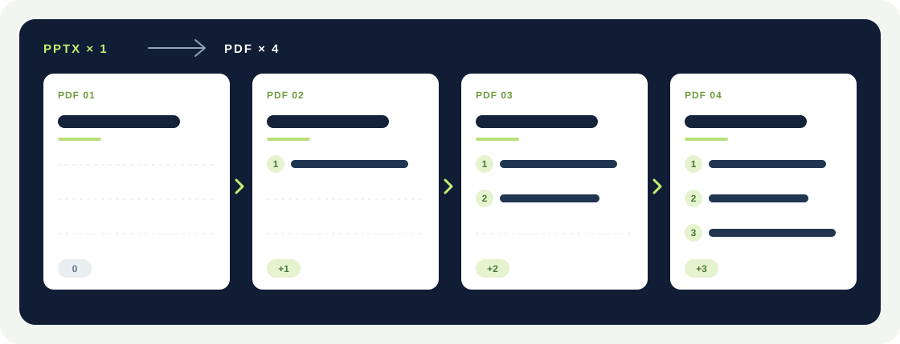
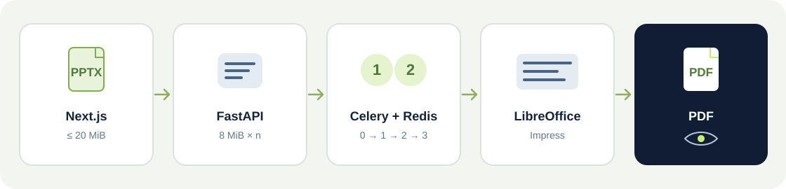

# Slides Bloom

[English](README.md) · [繁體中文](README.zh-TW.md) · **简体中文**

## 直接在线使用

**网站地址：** `https://slidesbloom.duckdns.org/`

[打开 Slides Bloom 在线版](https://slidesbloom.duckdns.org/)

[图解教程：将 PPT 点击动画逐页转成 PDF](https://slidesbloom.duckdns.org/zh-cn/ppt-animation-to-pdf)

在浏览器输入上方地址，或点击链接，即可上传 PowerPoint（`.pptx`）、将点击动画转换为逐页 PDF、预览并下载结果。网站免费使用，无需安装软件或注册账号。

**将 PPTX 的点击动画展开为可以逐页阅读的 PDF。** Slides Bloom 是免费、开源、可自行部署的工具。上传演示文稿后，它会按照原始动画顺序生成每次点击后的累积画面，让讲义或分享用 PDF 保留讲述节奏。

## 从 GitHub 安装到 Codex 桌面版

这是供本地 Codex 使用的 skill，不是普通 ChatGPT 网页对话可直接安装的插件。需要 ChatGPT 桌面版中的 Codex、Python 3，以及可连接 Slides Bloom 网站的网络；**不需要**安装 Docker 或自行部署转换服务。

1. 在 ChatGPT 桌面版打开 **Codex**，新建对话并粘贴：`Use $skill-installer to install https://github.com/HuibingLin/slides-bloom/tree/main/.agents/skills/slides-bloom-convert`。
2. 安装完成后开启新的 Codex 对话。如果没有看到 skill，重启桌面版；可以在侧边栏的 **Skills** 检查 `slides-bloom-convert`。
3. 在 Codex 打开本地项目文件夹，将 `.pptx` 放入该文件夹，然后说：`使用 $slides-bloom-convert 将 /文件的绝对路径/演示文稿.pptx 的点击动画转成 PDF`。
4. Codex 会运行 skill 中的 Python 脚本，并提供生成的 PDF 链接。脚本会把 PPTX 上传至 `https://slidesbloom.duckdns.org` 转换，文件上限为 20 MiB；请只转换愿意发送到该服务的文件。

### 手动下载并安装整个 skill 文件夹（macOS）

1. 打开 [Slides Bloom GitHub 仓库](https://github.com/HuibingLin/slides-bloom)，点击 **Code → Download ZIP**，下载后解压。GitHub 网页会下载整个仓库，不能直接把单个文件夹下载成 ZIP。
2. 打开解压后的 `slides-bloom-main` 文件夹。如果 Finder 没有显示 `.agents`，按 **Command + Shift + .** 显示隐藏文件夹。进入 `.agents/skills/`，复制**整个** `slides-bloom-convert` 文件夹，其中必须同时有 `SKILL.md` 和 `scripts/convert.py`；只下载 `SKILL.md` 无法转换。
3. 打开“终端”，运行 `mkdir -p ~/.agents/skills`。回到 Finder，按 **Command + Shift + G**，输入 `~/.agents/skills`，然后将 `slides-bloom-convert` 文件夹粘贴到这里。最终应有 `~/.agents/skills/slides-bloom-convert/SKILL.md` 和 `~/.agents/skills/slides-bloom-convert/scripts/convert.py`，中间不要多一层 `slides-bloom-main`。
4. 新建 Codex 对话，或重启桌面版，在侧边栏的 **Skills** 确认有 `slides-bloom-convert`。然后按照上面的第 3 步使用 skill 转换 PPTX。

其他操作系统和本地 skill 存放位置请参阅 [OpenAI 官方说明](https://learn.chatgpt.com/docs/build-skills)。

## 转换结果是什么样子？

假设一张幻灯片中的 ①、②、③ 依次出现，输出的 PDF 会有四页：



```text
第 1 页  原始起始画面，尚未点击
第 2 页  起始画面 + ①
第 3 页  起始画面 + ① + ②
第 4 页  起始画面 + ① + ② + ③
```

没有支持动画的静态幻灯片仍输出一页。同一次点击中同步或接续发生的进入效果会合并为同一 PDF 页。展开后的页面保持原始幻灯片顺序。

可以下载[一张幻灯片的动画 PPTX](frontend/public/examples/animation-steps-demo.pptx) 和[实际转换的四页 PDF](frontend/public/examples/animation-steps-demo.pdf) 对照查看。[在线教程](https://slidesbloom.duckdns.org/zh-cn/ppt-animation-to-pdf) 展示了四页画面。示例使用简单的英文文字进入动画；转换其他效果或字体时，请检查预览。

## 主要功能

- 上传最大 **20 MiB**（界面标为 20 MB）的 `.pptx`；以 8 MiB 分片传输，网络中断后重新选择同一文件即可续传。
- 后台异步分析动画并用 LibreOffice Impress 生成 PDF；界面显示上传和转换进度。
- 完成后可以在站内**逐页预览 PDF**，也可以在新标签页打开完整 PDF 或直接下载。
- 界面支持 English、繁體中文、简体中文；首次打开默认英文，浏览器会记住语言选择。
- 上传文件与生成的 PDF 在任务创建满 24 小时后，由每小时运行的清理任务移除。

## 技术栈

- **前端：** Next.js 15、React 19、TypeScript 和 CSS。界面构建为静态网站。
- **API 与文档处理：** Python 3.12 和 FastAPI 负责上传、任务状态及 PDF 预览；`lxml` 读取和修改 PPTX 动画数据，LibreOffice Impress 将展开后的幻灯片渲染为 PDF，`pypdf` 和 `pypdfium2` 用于 PDF 处理与预览。
- **后台任务与存储：** Celery 负责转换和定时清理；Redis 保存任务队列和进度。上传文件及 PDF 暂存于配置的数据目录，到期后清理。

## 快速启动

需要 Docker、Docker Compose，以及足够的可用内存和磁盘空间。Worker 的内存上限为 6 GB；建议为 Docker 提供超过 6 GB 的可用内存。解压和渲染所需空间可能远大于原始 PPTX，请将数据目录放在空间充足的本地 SSD 上。

在项目根目录执行：

```sh
cp -n .env.example .env
docker compose up --build -d
```

打开 [http://localhost:8080](http://localhost:8080)。如需更改对外端口或数据位置，请先编辑 `.env`：

```dotenv
PORT=8080
DATA_PATH=./data
```

`DATA_PATH` 存放上传分片、源文件和 PDF。`docker compose down` 会停止服务，但不会删除该目录中尚未过期的文件。自动清理需要 `beat` 服务持续运行。

### 确认服务正常

```sh
docker compose ps
curl http://localhost:8080/api/health
```

然后在页面上传一份含有点击进入动画的 PPTX。如果一张幻灯片有三次点击，预览中应看到起始画面及三个累积状态，共四页。需要查看处理记录时，可执行 `docker compose logs -f worker`。

## 系统组成



- **Next.js**：将上传、进度、语言切换、PDF 预览及下载界面构建为静态文件，由 Nginx 提供；正式环境不常驻运行 Node.js 服务。
- **Nginx / FastAPI**：网站与 API 入口、分片接收、文件验证、任务查询及预览图片。
- **Celery / Redis**：后台转换和进度通知。Worker 默认一次处理 1 个任务，容器内存上限为 6 GB，单个任务最长 2 小时；后续上传会排队。
- **Celery Beat**：每小时清理创建时间已超过 24 小时的任务文件。

Nginx 的单次请求体上限为 20 MiB；每个上传分片都小于此限制。上传时还会检查 PPTX 格式及解压后的安全上限。因此，20 MiB 是**文件上传上限**，并不保证每个这种大小的文件都能在特定机器的内存和磁盘容量下完成转换。

## 本地开发与测试

最简单的方式是先按上述 Compose 指令启动全部服务。如需在本机运行前端开发服务器：

```sh
cd frontend
npm ci
NEXT_PUBLIC_API_BASE=http://localhost:8080 npm run dev
```

开发页面位于 [http://localhost:3000](http://localhost:3000)，API 仍由 Compose 的 `localhost:8080` 提供。在 `frontend/` 中运行 `npm run build` 可以构建前端。

在项目根目录执行后端测试：

```sh
python3 -m venv backend/.venv
backend/.venv/bin/python -m pip install -r backend/requirements-dev.txt
PYTHONPATH=backend backend/.venv/bin/python -m unittest discover -s backend/tests -v
```

测试覆盖 20 MiB 限制、动画累积页面、公式图片遮罩，以及不支持动画的错误处理。完整的上传到 PDF 预览测试需要在本机安装 LibreOffice 的 `soffice`；如未安装，该项测试会跳过。通过 Docker 启动应用时，镜像已包含 LibreOffice。

## API 概览

- `GET /api/health`：健康检查和上传大小上限。
- `POST /api/uploads`：创建分片上传。
- `GET /api/uploads/{upload_id}`：查询已上传的分片。
- `PUT /api/uploads/{upload_id}/chunks/{index}`：上传单个分片。
- `POST /api/uploads/{upload_id}/complete`：完成上传并提交转换任务。
- `GET /api/jobs/{job_id}` 和 `WS /api/jobs/{job_id}/ws`：查询或订阅进度。
- `GET /api/jobs/{job_id}/preview/pages/{page_number}`：将 PDF 页面渲染为 PNG，页码从 **1** 开始。
- `GET /api/jobs/{job_id}/preview`：在浏览器中打开 PDF。
- `GET /api/jobs/{job_id}/download`：下载 PDF。

## 部署与故障排查

- **上传被拒绝或显示 413**：检查文件是否超过 20 MiB，以及前方是否还有请求体限制更低的反向代理。
- **动画转换失败**：查看界面提示的原始幻灯片页码和 `docker compose logs worker`。目前只支持上述点击进入动画。
- **公式或符号外观不同**：检查 PPTX 中是否有可用的公式备用图片，并在有授权的前提下安装所需字体。逐页预览 PDF 结果。
- **容器无法启动**：执行 `docker compose ps` 和 `docker compose logs --tail=100`，检查 `PORT` 是否被占用、`DATA_PATH` 是否有足够空间。

目前没有账号系统。公开部署前，请在入口配置 HTTPS，并根据使用场景增加访问控制、流量限制和监控。定时删除文件属于普通文件删除，不等同于存储设备级别的安全擦除。

## 搜索引擎收录

公开首页已加入描述性标题、摘要、分享图片和软件应用信息。静态构建会提供 `/robots.txt` 与 `/sitemap.xml`，私人 `/admin/` 页面不会被索引。

如果使用自己的公网域名，请在构建前于 `.env` 设置 `SITE_URL=https://your-domain.example`。该网址会写入前端的规范网址、站点地图和分享信息；修改后运行 `docker compose up --build -d frontend` 重新构建，再运行 `docker compose restart nginx`，使网关找到新容器。使用 `compose.oracle.yaml` 时，`SITE_DOMAIN` 应与之对应。公网部署不要将 `SITE_URL` 设为 `localhost`。

确认 HTTPS 网站可以公开访问后，将域名加入 [Google Search Console](https://search.google.com/search-console/about)。如选择 HTML 标签验证，将标签里的 `content` 值填入 `.env` 的 `GOOGLE_SITE_VERIFICATION`，重新构建前端并点击“验证”。然后提交 `https://your-domain.example/sitemap.xml`。站点地图可以帮助发现网页，但不能保证立即收录或获得排名。

如果选择 HTML 文件验证，把 Google 提供的文件原样放在 `frontend/public/`，重新构建并部署前端。确认 `https://your-domain.example/<文件名>.html` 可以返回 Google 指定的完整内容，再点击“验证”。验证后仍需保留该文件。

如果搜索不到，请在 Search Console 的**网址检查**中输入首页完整网址，查看索引状态、具体原因和 Google 选择的规范网址。用**测试实际网址**检查当前部署；若符合条件，再请求编入索引。搜索“PPT Animation to PDF”这类宽泛词同时受排名影响，无法单独证明是否收录。首页已提供可见的功能说明、转换步骤和常见问题。

## 许可证

项目代码采用 [MIT License](LICENSE)。LibreOffice、字体和其他依赖项分别遵循各自的授权条款。
